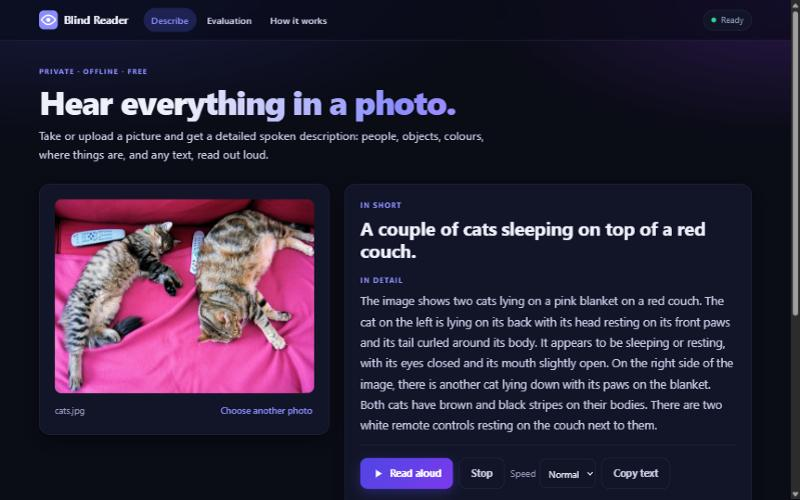

# 👁️ Blind Reader Assistant

A fully offline Python application that helps visually impaired users understand images by providing audio descriptions. The app uses open-source AI models to caption images, create accessible explanations, and convert them to speech.



## 🚀 Features

- **🖼️ Upload or Camera**: Upload a PNG/JPG or take a photo with your webcam
- **⚡ Automatic**: Each new photo is described and read aloud straight away, with no extra button to find
- **🔍 BLIP Captioning**: Uses Salesforce's BLIP model for accurate image descriptions
- **💡 Flan-T5 Explanation**: Converts raw captions into accessible explanations using Flan-T5
- **🔊 Text-to-Speech**: Offline speech with your OS voices (pyttsx3), with optional Coqui TTS or Bark
- **🎨 Clean, accessible UI**: Large text, works in light and dark mode, screen-reader friendly
- **🔄 Read Aloud Again**: One button to replay the description
- **🧠 Bring your own model**: Swap in your own fine-tuned captioning model from the Hugging Face Hub
- **⚡ Offline Operation**: No external APIs required - everything runs locally

## 🏗️ Architecture

The application follows a modular pipeline:

1. **Image Captioning** (`utils/image_captioning.py`): BLIP model generates raw captions
2. **Text Explanation** (`utils/text_explainer.py`): T5 model creates accessible descriptions
3. **Speech Synthesis** (`utils/tts_generator.py`): pyttsx3 (or optional Coqui/Bark) converts text to audio
4. **Web Interface** (`main.py`): Streamlit app orchestrates the entire process

## 📋 Requirements

- Python 3.9+ (3.9–3.11 if you want the optional Coqui TTS)
- 8GB+ RAM (recommended)
- GPU support (optional, for faster processing)
- Internet connection (only for initial model download)

## 🛠️ Installation

### Quick Start (Windows)
Run `run.bat`. It creates the virtual environment, installs the requirements and starts the app.

### Manual Setup

### 1. Clone the Repository
```bash
git clone https://github.com/AdityaWagh06/Blind_reader_app.git
cd Blind_reader_app
```

### 2. Create Virtual Environment
```bash
python -m venv venv
source venv/bin/activate  # On Windows: venv\Scripts\activate
```

### 3. Install Dependencies
```bash
pip install -r requirements.txt
```

### 4. Run the Application
```bash
streamlit run main.py
```

The app will be available at `http://localhost:8501`

## 🎯 Usage

1. **Choose a photo**: Upload one, or switch to the **Camera** tab and take one
2. **Listen**: The description appears and is read aloud automatically (the first run downloads the models, about 1 GB)
3. **Replay**: Press **Read aloud again**
4. **Details**: Open **Details** to see the raw caption and processing time

## 🔧 Configuration

### Model Selection
- **BLIP Model**: [`adityawagh07/blip-vizwiz`](https://huggingface.co/adityawagh07/blip-vizwiz), our BLIP fine-tuned on VizWiz (base: `Salesforce/blip-image-captioning-base`)
- **T5 Model**: `google/flan-t5-small` (can be changed to `google/flan-t5-base` for better quality)
- **TTS Engine**: Coqui TTS if installed, otherwise pyttsx3 (built-in OS voices). Bark is supported but off by default because it is very slow on CPU

### Performance Optimization
- **GPU**: Automatically detected and used if available
- **CPU Fallback**: Works on CPU-only systems (slower but functional)
- **Model Caching**: Models are cached after first download

## 🌐 APIs and Models

The app calls **no paid or cloud API**. The only network access is a one-time download of model weights from the [Hugging Face Hub](https://huggingface.co); after that everything runs on your machine and photos never leave it.

| Step | Model | Size | Runs on |
|------|-------|------|---------|
| See | [`adityawagh07/blip-vizwiz`](https://huggingface.co/adityawagh07/blip-vizwiz), fine-tuned from [`Salesforce/blip-image-captioning-base`](https://huggingface.co/Salesforce/blip-image-captioning-base) | ~900 MB | Local CPU/GPU |
| Explain | [`google/flan-t5-small`](https://huggingface.co/google/flan-t5-small) | ~300 MB | Local CPU/GPU |
| Speak | pyttsx3 (Windows SAPI5 / macOS NSSpeech / Linux espeak) | built in | Local |

Libraries: Hugging Face `transformers` + PyTorch for the models, Streamlit for the UI.

## 🧠 Use Your Own Model

The captioning model is set in `config.py`:

```python
BLIP_MODEL = "adityawagh07/blip-vizwiz"  # BLIP fine-tuned on VizWiz; base: "Salesforce/blip-image-captioning-base"
```

Any BLIP captioning model on the Hugging Face Hub (or a local folder) works. You can also switch without editing code:

```powershell
$env:BLIND_READER_BLIP_MODEL = "<your-username>/blip-vizwiz"; .
un.bat
```

## 📈 Our Fine-tuned Model: Results

[`adityawagh07/blip-vizwiz`](https://huggingface.co/adityawagh07/blip-vizwiz) was trained on a free Colab T4 GPU in about 28 minutes: 7,362 VizWiz photos, 3 epochs, with 388 photos held out for evaluation. The best epoch (2) was kept automatically.

| Held-out loss (lower is better) | |
|---|---|
| Start of training | ~3.8 |
| Epoch 1 | 2.326 |
| **Epoch 2 (published)** | **2.291** |
| Epoch 3 (started to overfit) | 2.338 |

| Photo | Original BLIP | Fine-tuned |
|---|---|---|
| Two cats on a couch | two cats sleeping on a couch. | a couple of cats sleeping on top of a red couch. |
| Same photo, heavily blurred | a pink background with a blur effect. | quality issues are too severe to recognize visual content. |
| Drawing of a house | an image of a house in the middle of a field. | a house with a red roof and a yellow sun in the background. |

When the model reports a photo is unreadable, the app tells the user to retake it with tips instead of describing noise. **Known limitation:** it sometimes says this for photos a person could read, because many VizWiz training photos are labelled that way.

## 🏋️ Fine-tuning on VizWiz (free)

`training/` fine-tunes BLIP on [VizWiz-Captions](https://huggingface.co/datasets/lmms-lab/VizWiz-Caps): about 7,700 photos **taken by blind people**, often blurry, badly framed or of text, each with a human-written description. That is exactly the kind of photo this app receives, so it is the most useful thing to train on.

1. Open [`training/finetune_blip_colab.ipynb`](training/finetune_blip_colab.ipynb) in Google Colab and pick a free **T4 GPU** runtime.
2. Run the cells. You sign in with your own Hugging Face write token; training takes roughly 30–45 minutes.
3. The model is published free to `https://huggingface.co/<your-username>/blip-vizwiz`.
4. Set `BLIP_MODEL` in `config.py` to that name.

The notebook shows live loss charts with TensorBoard. To train on your own machine instead:

```powershell
pip install datasets accelerate tensorboard
python training/finetune_blip.py --hub_repo <your-username>/blip-vizwiz
tensorboard --logdir blip-vizwiz/logs   # live charts at http://localhost:6006
```

Quick check that everything works (16 photos, 2 steps, no upload):

```powershell
python training/finetune_blip.py --limit 16 --max_steps 2 --batch_size 2
```

## 🐛 Troubleshooting

### Common Issues

1. **Out of Memory Error**
   - Reduce image size before uploading
   - Close other applications
   - Use CPU-only mode if GPU memory is insufficient

2. **Model Download Issues**
   - Check internet connection
   - Clear HuggingFace cache: `rm -rf ~/.cache/huggingface/`

3. **Audio Not Playing**
   - Check browser audio settings
   - Try different browser
   - Verify system audio is working

4. **Slow Processing**
   - First run downloads models (30-60 seconds)
   - Subsequent runs are faster
   - GPU acceleration recommended for better performance

### Error Messages

- **"Failed to load BLIP model"**: Check internet connection and try again
- **"Failed to load T5 model"**: Verify transformers installation
- **"TTS failed"**: The app falls back from Coqui TTS to pyttsx3 automatically. On Linux, pyttsx3 needs espeak (`sudo apt install espeak`)

## 📁 Project Structure

```
blind_reader_app/
├── main.py                 # Main Streamlit application
├── config.py               # Model names and settings
├── .streamlit/config.toml  # UI theme
├── training/               # Fine-tuning script and Colab notebook
├── requirements.txt        # Python dependencies
├── README.md              # This file
├── utils/                 # Utility modules
│   ├── __init__.py
│   ├── image_captioning.py    # BLIP image captioning
│   ├── text_explainer.py      # Flan-T5 text explanation
│   └── tts_generator.py       # Text-to-speech (pyttsx3, optional Coqui/Bark)
└── assets/                # Static assets
    ├── sample.png          # Sample image for testing
    └── screenshot.png      # README screenshot
```

## 🤝 Contributing

1. Fork the repository
2. Create a feature branch
3. Make your changes
4. Add tests if applicable
5. Submit a pull request

## 📄 License

This project is licensed under the MIT License - see the LICENSE file for details.

## 🙏 Acknowledgments

- **Salesforce** for the BLIP model
- **Google** for the T5 model
- **Suno AI** for Bark TTS
- **Coqui AI** for Coqui TTS
- **pyttsx3** for offline text-to-speech
- **Streamlit** for the web framework

## 📞 Support

For issues and questions:
1. Check the troubleshooting section above
2. Search existing GitHub issues
3. Create a new issue with detailed information

## 🔮 Future Enhancements

- [ ] Support for video files
- [ ] Multiple language support
- [ ] Custom voice selection
- [ ] Batch processing
- [ ] Mobile app version
- [ ] Integration with screen readers
- [ ] Real-time processing
- [ ] Advanced accessibility features

---

**Made with ❤️ for the visually impaired community** 